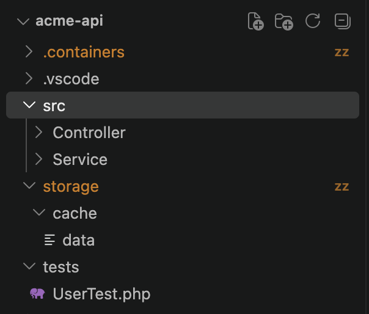

# Lull

Lull noisy folders in VS Code: exclude them from the file watcher, automatically or by hand.

Huge folders that change constantly (database volumes, caches, build output) flood VS Code's file watcher with events. Explorer, Git and other extensions then slow down or hang. Lull adds such folders to `files.watcherExclude` for you.

## Features

- **Manual:** right-click a folder in Explorer → **Lull Folder** / **Unlull Folder**. Multi-select works.
- **Automatic:** on startup Lull scans gitignored folders, counts their files and offers to exclude the heavy ones.
- **Highlight:** lulled folders get a `zz` badge and a muted color in Explorer.
- **Safe rollback:** Lull remembers what it added; **Unlull All Folders** removes only its own entries.

## Commands

| Command | Description |
| --- | --- |
| `Lull: Lull Folder` | Exclude the selected folder(s) from the file watcher |
| `Lull: Unlull Folder` | Remove the selected folder(s) from the exclusion |
| `Lull: Scan Ignored Folders` | Find heavy gitignored folders and pick which to exclude |
| `Lull: Unlull All Folders` | Remove every entry added by Lull |

## Settings

| Setting | Default | Description |
| --- | --- | --- |
| `lull.mode` | `suggest` | `off`, `suggest` (ask on startup) or `auto` (exclude without asking) |
| `lull.threshold` | `5000` | Minimum file count for an ignored folder to count as heavy |
| `lull.neverExclude` | `node_modules`, `vendor`, `dist`, `build`, `.git` | Folder names the scan never excludes |

## Notes

- Entries are written to `files.watcherExclude` in workspace settings (`.vscode/settings.json` or the `.code-workspace` file). Add `.vscode/settings.json` to `.git/info/exclude` to keep it out of git.
- Excluded folders are no longer watched: Explorer and open files inside them do not refresh on their own.
- Auto mode shows what it excluded with an **Undo** button.
- Only the repository root is scanned: submodules and nested repositories are not.
- Only gitignored folders are scanned. Tracked sources are never touched by the automatic mode.

## License

MIT
